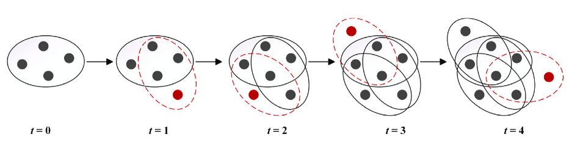
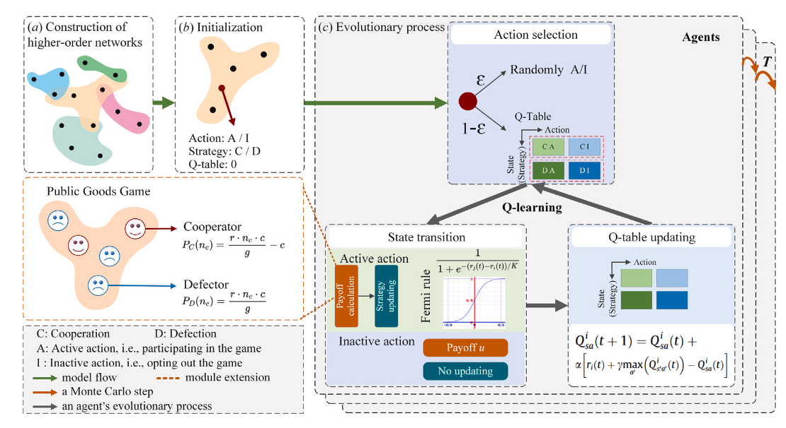
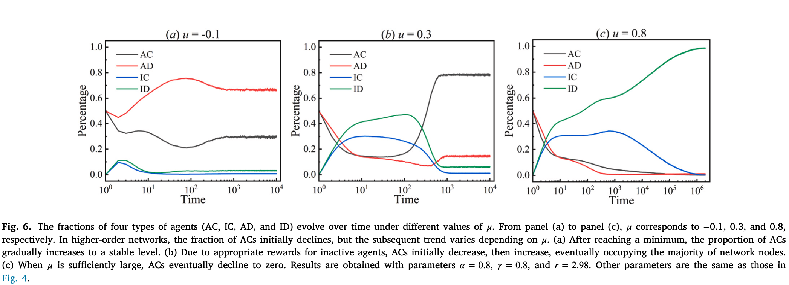
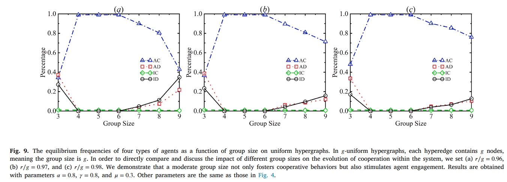

# MAgent: A Many-Agent Reinforcement Learning Platform for Artificial Collective Intelligence

Authors: Lianmin Zheng et al.  
Venue: NIPS 2017 and AAAI 2018  
Github Link : [Github](https://github.com/geek-ai/MAgent)  
Demo Video: [Youtube](https://www.youtube.com/watch?v=HCSm0kVolqI)  

---

  

### Contribution
 - They proposed a highly scalable **Many Agent** platform that can host millions of agents on a GPU server.
 - MAgent provides environment, agent configurations, and a reward description language to enable flexible environment design.
 - Illustrate three running examples of **Many Agent** simulation of pursuitting, gathering, and battlefield agents.
 - Implemented three parameter-sharing DQN, DRQN, and A2C and found DQN performed best in their setting.

 ### Limitations
 - Not enough technical details about the environment, agent communications, reward design, states, and actions.
 - Not provided architectural details of the platform.

 Note: Maybe they shared it in another paper; I have to find that out to understand the internal mechanics.

 ---

 # Multi-Agent Deep Reinforcement Learning: A Survey
 Authors: Sven Gronauer and Klaus Diepold
 
Venue: AI Review, 2022. Springer  
GitHub:  

### Contribution
In this survey, they addressed
- Training Schemes of MARL
  - Centralized Training, Centralized Execution (CTCE)
  - Centralized Training, Decentralized Execution (CTDE)
  - Distributed training, decentralized execution (DTDE)
- Agent Behaviour Patterns
  - Cooperative
  - Competitve
  - Mixed Scenarios
- Kernel Challenges in MARL
  - Non-stationarity
  - Shadowed Equilibrium
  - Partially Observable Markov Games
  - Credit Assignment Problem
 
- Messaging between Agents
  - Broadcasting Communication, where an agent broadcasts information to all participants in the channel.
  - Networked Communication, where agents exchange information with their neighbourhood.
- Future Direction
  - **Multi-goal learning**. where each agent optimizes its own goal instead of joint action or reward.
  - **Multi-task Learning**, agent not only performs one task, but also other related tasks.
  - **Safe MADRL**
--- 
# Reinforcement learning and Collective Cooperation on higher-order networks
Authors: Yan Xu et al.  
Venue: Elsevier --- Knowledge-Based Systems  
GitHub: Not provided 
[Paper Link](https://www.sciencedirect.com/science/article/pii/S0950705124009602)

In this paper, they combined **Evolutionary Game Theory** with **RL** to investigate the influence of a dynamic environment on **Group Cooperation**. **Active agent** used social learning to update policy over time, whereas for **inactive agent** they introduced **varying reward*** to maintain cooperation. From their investigation, they found that **meduim sized** environment is favourable for collective cooperation.

### What is Evolutionary Game Theory?
Evolutionary Game Theory **(EGT)**, studies the games played by not a few rational, calculated player, but a large populations whose strategies spread  or die out over time based on their performance. 

**EGT ASK:** _If large numbers of individuals with different strategies keep meeting each other, which strategies will take over the population?_

### What is the Public Goods Game?
It is a **group game**, where each player decides how to contribute to a **shared pot**. After that, the pot is multiplied by a factor of $r$ (where $1 < r < N$) and split **equally** among all players. The condition of the multiplier factor is the **dilemma**: if you contribute and others do not, your return will be $\frac{\text{your contribution} \times r}{N}$, which will be less than your actual contribution.

## Proposed Model
Their framework consists of three integral parts: **Higher-order network constuction**, **Initialization**, and **Evolutionary process**.
### 1. Higher-order Network Construction
To generate the hypergraph,
- **Initialize**: Start with $g$ nodes; every hyperedge should have g nodes.
- **Hyperedge growth**: Added $m \in[1,g)$ new nodes and combine them with $(g-m)$ exisiting nodes.
- **Preferential Attachment**: Probability of selection node $i$ is proportional to  its hyperdegree $d_H(i)$
  $$\muld_H(i) = \frac{d_H(i)}{\sum_{j\inN}d_H(j)}$$. A node in many groups is more likely to be picked again.
- Repeat steps 2 and 3 until an N-node hypergraph is generated.

---
### 2. Initialization
Nodes correspond to agents, and hyperedges correspond to connections among them. 
- Strategy (row) $S = \{C,D\}$, C means **Cooperation** and D means **Defection**(do noting).
- Actions (columns) $A = \{A,I\}$, A means **Active** (Stay in the game) and I means **Inactive** (Leave the game)
- Each agent has its own Q-table
- All entries are initialized to $0$

**Q-table of agent *i* at time *t* (Eq. 6)**

| State \ Action | A (active) | I (inactive) |
|---|---|---|
| **C** (cooperate) | QiC,A(t) | QiC,I(t) |
| **D** (defect) | QiD,A(t) | QiD,I(t) |

### 3. Evolutionary process
This process comprises of three parts: **Action Selection**, **State Transition** and **Q-table updating**
#### Action Selection
They used $\eplison$- greedy approach to select the action. The agent selects the action that has the highest Q-value from the Q-table.
#### State Transition
After executing the action, the agent receives the **payoff** and transitions to a new state(strategy)  

**Payoff Calculation**
---
 

$$\pi_i(t) = \sum_{h=1}^{k_i} \pi_i^{h} \quad \text{if } a_i = A$$

$$\pi_i(t) = k_i \mu \quad \text{if } a_i = I$$

$$\pi_i^{h} = -c\,s_i + \frac{r\,c\,x_h}{x_h + y_h}$$

where:

- $\pi_i(t)$ is the total payoff of agent $i$ at time step $t$
- $a_i$ is the action of agent $i$: $A$ = active, $I$ = inactive
- $k_i$ is the hyperdegree of agent $i$ (the number of hyperedges it belongs to)
- $\pi_i^{h}$ is the payoff agent $i$ gets from the $h$-th hyperedge it belongs to
- $\mu$ is the fixed reward for an inactive agent, received from every hyperedge it belongs to
- $c$ is the amount a cooperator invests in the pool
- $r$ is the multiplication factor of the pool
- $s_i$ is the strategy of agent $i$: $s_i = 1$ for cooperation, $s_i = 0$ for defection
- $x_h$ and $y_h$ are the numbers of active cooperators and active defectors in the $h$-th hyperedge

**Strategy Updating**  
---
Agent $i$ **randomly** selects an agent $j$, the likelyhood of selecting the **strategy** of agent $j$ is  

$$\varphi\big(s_i(t+1) \leftarrow s_j(t)\big) = \frac{1}{1 + e^{-\left(r_j(t) - r_i(t)\right)/K}}$$

**Limit $K \to 0$  select optimal strategy deterministically**

Agent $i$ always copies $j$ if $j$ earns more, and never copies $j$ if $j$ earns less.

**Limit $K \to \infty$ selects randomly:**

## Results
### Varying Reward Effect

AC = Active and Cooperative | AD = Active but Defactor | IC = Inactive and Cooperative | ID = Inactive and Defactor  

- **Left Panel:** When $\mu$ is negative, **leaving games** gives low payoff, **Playing is better**. So the agent stays in the game, but most of them are **defactors**, they do not cooperate.  
- **Middle Panel:** $\mu$ is higher, so AC and AD decrease. **AC gets more payoff when it is around AC**, **AD becomes ID**.  
- **Right Panel:** The reward is so high that almost every agent earns more by leaving.

### Agent Group Size Effect

$g$ uniform hyperedge, $g$ is the number of agents in each hyperedge. 
- They observed the **highest proportion of AC** when g is $4 to 6$.

---
## Future Directions
- Incorporation of **Global Environment Effect** on the proportion of the agents.
